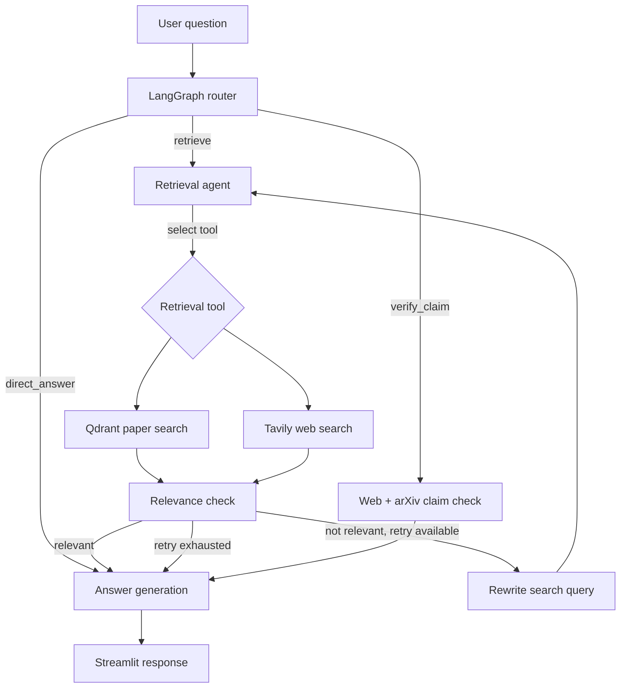

# 🧠 PaperMind — Agentic RAG Research Assistant

**PaperMind** is a research assistant built with **LangGraph, LangChain, OpenAI, Qdrant, Tavily, and Streamlit**. It lets users ingest research papers and other sources, ask evidence-grounded questions, search for newer information, and investigate whether published claims have been challenged or superseded.

Unlike a fixed retrieval pipeline, PaperMind routes requests between **document/web retrieval**, **research-claim verification**, and **direct answers**. Its retrieval workflow includes tool selection, relevance assessment, and a bounded query-rewriting retry.

## ✨ Features

- **Agentic question routing:** Structured-output router selects `retrieve`, `verify_claim`, or `direct_answer`.
- **Tool-driven retrieval:** A LangGraph agent chooses between session-specific Qdrant vector search and Tavily web search.
- **Evidence-grounded answers:** Generates answers from retrieved passages and includes numbered evidence references; provides a fallback when relevant context is unavailable.
- **Retrieval quality checks:** LLM-based relevance assessment and up to one rewritten-query retry.
- **Research claim checks:** Searches the web and arXiv for newer papers, returning a verdict and up to three related papers with links.
- **Multiple ingestion sources:** Local PDF, TXT, and Markdown files; public web pages and PDF URLs; arXiv titles, IDs, and URLs.
- **Document preprocessing:** Text cleaning, recursive chunking, source metadata, scanned-PDF warnings, and bounded HTTP downloads.
- **Session-isolated knowledge bases:** Each chat has its own Qdrant collection.
- **Embedding cache:** OpenAI embeddings are cached locally with `CacheBackedEmbeddings` and `LocalFileStore`.
- **Persistent chats:** SQLite-backed LangGraph checkpoints plus JSON-backed Streamlit chat display data.
- **Streamlit interface:** Multi-chat management, file/URL/arXiv ingestion, workflow progress indicators, and streamed answers.
- **RAG evaluation:** DeepEval-based synthetic question generation and five evaluation metrics.

## 🧭 Architecture



**Ingestion:** Source → loader and text cleaning → overlapping chunks + metadata → cached OpenAI embeddings → session-specific Qdrant collection.

**Memory:** Each Streamlit chat ID is used as the LangGraph `thread_id`; SQLite checkpoints preserve graph state across turns. The retrieval agent limits its conversational context to the last **12 eligible user/assistant messages**, while the saved thread history can be longer.

## 🛠️ Technology stack

| Layer | Technologies |
|---|---|
| Agent orchestration | LangGraph, LangChain |
| LLM and embeddings | OpenAI `gpt-5.4-mini`, `text-embedding-3-small` |
| Vector storage | Qdrant, cosine similarity |
| Web and research discovery | Tavily, arXiv API |
| Application UI | Streamlit |
| Conversation persistence | SQLite (`SqliteSaver`), local JSON |
| Embedding caching | `CacheBackedEmbeddings`, `LocalFileStore` |
| Document processing | PyMuPDF, Beautiful Soup, LangChain text splitters |
| Evaluation | DeepEval |

## 📁 Project structure

The following shows the **relevant files** based on the supplied implementation; other repository files may differ.

```text
agentic-rag/
├── PaperMind_Streamlit.py          # Streamlit application (repository root)
├── src/
│   └── agentic_rag/
│       └── core/
│           ├── Agentic_rag1.py     # LangGraph routing and agent workflow
│           ├── QdrantVector_Store.py # Qdrant storage and retrieval
│           ├── rag_loaders.py      # File, web and arXiv ingestion
│           └── embedding_cache/    # Generated local embedding cache
├── .papermind/
│   └── chats.json                  # Generated chat display history
├── checkpoints.db                  # Generated LangGraph checkpoints
├── README.md
└── ...                            # Dependency and evaluation files, as present
```

The evaluation script uses six local PDF paths and writes `dataset_6papers.json`, `evaluation_results_6papers.json`, and `eval_checkpoints.db`. Move its document paths to your own machine before running it.

## 🚀 Getting started

### 1. Clone the repository

```bash
git clone https://github.com/shubhamkhandelwal121996-hue/agentic-rag.git
cd agentic-rag
```

### 2. Install dependencies

Use a Python virtual environment. If the repository includes a working `pyproject.toml` / `uv.lock`, you can install the project with:

```bash
uv sync
```

Alternatively, if a `requirements.txt` is provided:

```bash
python -m venv .venv
# Windows PowerShell:
.venv\Scripts\Activate.ps1
pip install -r requirements.txt
```

The code depends on packages including `streamlit`, `python-dotenv`, `langgraph`, `langgraph-checkpoint-sqlite`, `langchain-openai`, `langchain-qdrant`, `qdrant-client`, `langchain-community`, `langchain-text-splitters`, `langchain-classic`, `tavily-python`, `pymupdf`, `beautifulsoup4`, and `deepeval` (for evaluation). **Exact dependency versions were not provided in the reviewed files.**

### 3. Configure environment variables

Create a `.env` file in the repository root (the main graph and evaluation script call `load_dotenv()`):

```dotenv
OPENAI_API_KEY=your_openai_api_key
TAVILY_API_KEY=your_tavily_api_key
QDRANT_URL=your_qdrant_cloud_url
QDRANT_API_KEY=your_qdrant_api_key
```

`QdrantVector_Store.py` explicitly looks for `.env` alongside that module; if you rely on running it independently, ensure the environment variables are already exported or put an appropriate `.env` in that module's directory. **Never commit credentials or `.env` files.**

### 4. Launch PaperMind

From the repository root:

```bash
streamlit run PaperMind_Streamlit.py
```

Open the local URL displayed by Streamlit (usually `http://localhost:8501`). The application expects a `src/agentic_rag/core/` package layout and imports `Agentic_rag1.py`, `QdrantVector_Store.py`, and `rag_loaders.py` from it.

## 💬 How to use

1. **Create or select a chat** in the sidebar.
2. **Add research material:** upload PDF/TXT/Markdown, index a public URL, or find an arXiv paper by title/ID/link.
3. **Ask questions** about methods, datasets, results, or conclusions in the indexed papers.
4. **Ask about recent developments** to trigger web retrieval, or ask whether a specific finding has been superseded to use claim verification.
5. **Review the response** and its numbered evidence references. Rename or delete chats as needed; deletion attempts to remove their Qdrant collection and LangGraph checkpoint history.

Example prompts:

- “Summarize the main contributions of this paper.”
- “What datasets and evaluation metrics were used?”
- “Compare the methods described in these papers.”
- “Has this paper’s main claim been challenged by newer research?”

## 📊 Evaluation with DeepEval

The supplied evaluation pipeline uses **six research papers**, generates or loads synthetic golden questions, runs them through PaperMind, and evaluates retrieval and answers using **DeepEval**. It uses a **0.70 per-metric pass threshold** and evaluates only cases routed to retrieval.

### Results — 48 evaluated questions, 0 skipped

| Metric | Mean score |
|---|---:|
| Faithfulness | **97.53%** |
| Contextual Precision | **95.14%** |
| Answer Relevancy | **94.89%** |
| Contextual Recall | **90.17%** |
| Contextual Relevancy | **60.70%** |

*These are averages of DeepEval metric scores across the 48 recorded cases, not independently measured factual accuracy or benchmark-wide guarantees. At the configured threshold, 22 of 48 cases passed all evaluated metrics.*

**Interpretation:** The evaluation shows strong average faithfulness, answer relevancy, and retrieval precision. **Contextual relevancy is the clearest improvement opportunity**: retrieved chunks sometimes contain tangential material even when answers remain useful.

### Running the evaluation

Update the six absolute PDF paths in the evaluation script (`DOCUMENT_PATHS`) to point to your local copies, ensure the required environment variables are set, and run the script from an environment where the `agentic_rag` package is importable. The script saves generated questions and detailed per-case results as JSON. The exact evaluation script filename was not included in the supplied code.

## ⚙️ Implementation details

- **Embedding dimension:** 1,536; cosine similarity in Qdrant.
- **Chunking:** 1,000 characters with 150-character overlap; `add_start_index=True`.
- **Paper retrieval:** The agent's vector-search tool requests the top **3** passages.
- **Retry policy:** At most **one** query rewrite after a relevance failure.
- **Evidence budget:** At most **10** retrieved documents included in answer generation.
- **Claim verification:** Two concurrent Tavily searches (general research and arXiv-focused); up to three newer papers returned.
- **Web safety controls:** URL/IP validation, redirect checking, timeouts, retries, and a 50 MB download cap; these reduce risk but are not a guarantee of complete protection against hostile URLs.

## 🔭 Potential improvements

- Improve contextual relevancy with reranking, metadata filters, and retrieval-specific evaluation.
- Add stronger verification of quoted claims and source provenance.
- Add automated tests, CI, and deployment configuration.
- Provide configurable retrieval settings and optional conversation summarization.

## 🔐 Security and data notes

This application sends relevant content to external services such as OpenAI, Qdrant Cloud, and Tavily. Avoid uploading confidential papers without reviewing the providers' data policies. Local chat JSON, SQLite checkpoint files, cached embeddings, and credentials should be excluded from version control.

Suggested `.gitignore` entries:

```gitignore
.env
.env.*
!.env.example
.venv/
__pycache__/
*.pyc
.papermind/
**/embedding_cache/
*.db
*.db-shm
*.db-wal
```

---

**PaperMind** — Explore research papers, retrieve supporting evidence, and investigate how scientific findings evolve.
